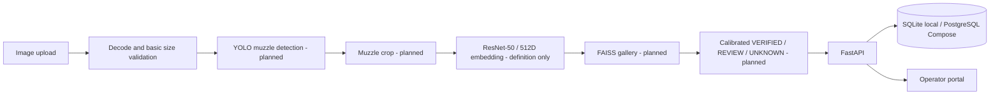

# MuzzleID

**Cattle muzzle identity, built for careful verification.**

MuzzleID is an early-stage web application foundation for organizing cattle records and developing muzzle-biometric identification. It combines a FastAPI service, a searchable animal registry, image uploads, and a simple operator portal.

> [!IMPORTANT]
> **Prototype only.** This repository does not contain a trained biometric checkpoint, a YOLO detector, a FAISS gallery index, or calibrated decision thresholds. Animal registration stores metadata and reference images as `pending_model`; it does not create a biometric profile. Verification deliberately returns HTTP `503` while the pipeline is unavailable. Do not use MuzzleID for insurance, ownership, or other consequential decisions.

## What works today

| Capability | Status |
|---|---|
| Operator portal with dashboard, registry, registration, identify, history, details, and system-status views | Available |
| Animal metadata and 1–8 reference-image registration | Available; saved as `pending_model` |
| Upload validation, generated storage names, and database persistence | Available |
| Registration retries with an `Idempotency-Key` | Available |
| Registry search, sorting, pagination, and animal details | Available |
| Image quality checks | Decode and minimum-dimension checks only |
| ResNet-50 512D normalized embedding model definition | Code present; not trained or validated here |
| Triplet metric-learning loss definition | Code present; training pipeline not implemented |
| YOLO detection, FAISS search, calibrated decisions, biometric verification | Unavailable |
| Insurance, fraud review, analytics, reports, roles, and external integrations | Planned |

The portal and API run on the same origin. The frontend is static HTML, CSS, and JavaScript served by FastAPI; there is no separate Node/React build step.

## Architecture

The target biometric flow is shown below. The model, detector, index, and calibrated decision stages are **planned and not currently connected**.



### Current service routes

| Method | Route | Behavior |
|---|---|---|
| `GET` | `/api/health` | Reports API/database status and availability flags for model, detector, index, and thresholds. |
| `GET` | `/api/animals?q=&offset=&limit=&sort=` | Searchable, paginated registry. Sort options: `created_at`, `name`, `ear_tag`. |
| `GET` | `/api/animals/{id}` | Animal metadata and stored reference-image metadata. |
| `POST` | `/api/animals` | Multipart animal registration; requires an `Idempotency-Key` header and 1–8 `images`. |
| `POST` | `/api/verify` | Validates the uploaded image, then returns `503` until complete model artifacts and thresholds exist. |
| `GET` | `/api/history` | Stored verification events; remains empty until verification is implemented. |

Interactive API documentation is served at `/docs` while the service is running.

## Quick start: Windows PowerShell

Python 3.10 or 3.11 is recommended. The lightweight dependency file runs the portal/API without installing the ML stack.

```powershell
py -3.11 -m venv .venv
.\.venv\Scripts\Activate.ps1
python -m pip install --upgrade pip
python -m pip install -r requirements-mvp.txt

$env:DATABASE_URL = "sqlite:///./muzzleid.db"
$env:UPLOAD_DIR = "./storage/uploads"
python -m uvicorn src.api.main:app --reload
```

Open [http://127.0.0.1:8000](http://127.0.0.1:8000) for the portal and [http://127.0.0.1:8000/docs](http://127.0.0.1:8000/docs) for the API.

Settings can also be placed in a local `.env` file; `.env` is ignored by Git. `.env.example` provides local SQLite defaults and a blank `POSTGRES_PASSWORD` field. Docker Compose requires you to set that value privately before starting the PostgreSQL stack. Explicit process environment variables take precedence over `.env` values.

## Docker Compose

Compose starts PostgreSQL and the API, which also serves the portal:

```powershell
# First set POSTGRES_PASSWORD to a private local value in .env.
docker compose up --build
```

Then open `http://localhost:8000`. The image installs the full `requirements.txt`, including the ML dependencies. Docker Compose was not verified in the current development environment because the Docker Desktop engine was unavailable. GPU container support is not configured.

## Dataset audit and handling

The observed data layout is:

```text
data/
├── train/dataset/<cattle_identity>/*
└── test/Cattle Muzzle - DB/{Original,Modified}/<numeric_identity>/*
```

The test subsets also have flat `*Master` folders that mirror class images. The latest audit found 4,943 training images across 268 folders and 743 distinct images across 24 identities in each test subset; no unreadable image files were detected. Literal train/test folder labels do not overlap, but identity-level separation is **not confirmed** because the label schemes differ. Do not train, tune, select a model, or calibrate thresholds on test data.

Run the read-only audit locally:

```powershell
python -m src.data.validation
```

This generates `reports/dataset_report.json` and `reports/dataset_report.md`. The JSON includes image-level paths, duplicate groups, and identity labels; it is intentionally excluded from Git to avoid publishing dataset-level details. Never add raw data or generated test samples to a public commit.

## Model and evaluation status

`src/models/embedding_model.py` defines a ResNet-50 encoder with a 512D linear head and L2-normalized output. It requests ImageNet pretrained weights. `src/models/losses.py` defines batch-hard triplet loss. The repository does **not** yet provide executable training, evaluation, threshold-calibration, checkpoint-selection, FAISS-index, or YOLO-inference pipelines. No accuracy, FAR, FRR, EER, or open-set metrics are available.

Install the full ML dependencies from `requirements.txt` only when preparing an ML development environment. PyTorch must be compatible with the chosen operating system and CPU/GPU. There are no trained weights in this repository.

## Data model and uploads

SQLAlchemy stores:

- `animals` — metadata and profile status.
- `animal_images` — generated storage key, SHA-256 digest, and decoded dimensions.
- `registration_requests` — idempotency keys for safe retries.
- `verifications` — reserved for persisted decisions once inference exists.

The local default is SQLite. Docker Compose configures PostgreSQL. Registration accepts up to eight images, each at most 12 MiB; images must decode and be at least 160 × 160 pixels. Files are named using generated UUIDs. These checks do not determine whether an image contains a cattle muzzle or whether its quality is sufficient for biometric matching.

## Tests

Run backend unit and API tests:

```powershell
python -m pytest -q -p no:cacheprovider tests
```

The API tests cover registration persistence, idempotent retries, invalid/duplicate images, registry search, details, and the expected unavailable-verification response. There is no frontend test runner or production-build configuration; browser checks have been performed manually during development.

## Security and limitations

- `.env`, local databases, uploads, datasets, model weights, and Python caches are excluded by `.gitignore`.
- Upload sizes and image decoding are validated; user-supplied filenames are not used as storage paths.
- The API currently has no authentication, authorization, organization isolation, rate limiting, retention controls, malware scanning, or database migration framework. Do not expose it to untrusted networks.
- The API does not yet persist image embeddings or maintain a FAISS index. Database/index consistency, deletion behavior, and biometric recovery after restart are not implemented.
- A saved animal record is not a verified biometric identity. Insurance and fraud workflows are not available.

## Project layout

```text
src/
├── api/            FastAPI routes and application
├── config.py       Environment-backed settings
├── data/           Dataset audit
├── database/       SQLAlchemy records and session setup
├── inference/      Basic image validation and decision utility
└── models/         ResNet-50 embedding model and metric loss definitions
web/                Static operator portal and shared API client
tests/              Unit and API tests
reports/            Dataset and system reports
```

## Roadmap

1. Confirm dataset identity provenance and leakage boundaries.
2. Implement reproducible training and validation-only threshold calibration.
3. Add detector, preprocessing contract, embedding generation, persistent gallery, and index rebuilds.
4. Complete real registration and verification flows with open-set evaluation.
5. Add authentication, organization roles, migrations, and audit controls.
6. Build insurance, alerts/review, analytics, reporting, and integration workflows after biometric validation.
